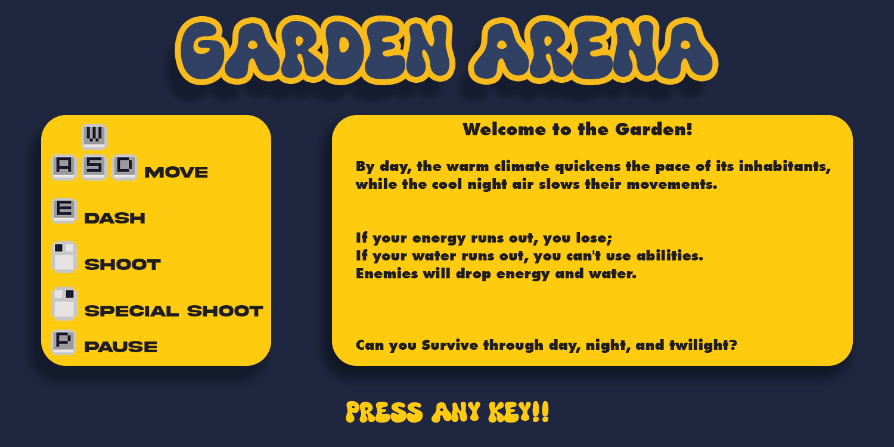

# Garden Arena

A top-down shooter built in Python with Pygame for the **Pygame Community Spring Jam 2024**.

**Result:** 9th overall out of 26 entries, and 4th in Engagement.

[](https://www.youtube.com/watch?v=g5BVIqjZY-I)

Click the image to watch 28 seconds of gameplay.

## The game

You play a flower defending your garden. Survive the day and the night, and reach the final boss.

- Day and night cycle, each with its own music and enemies.
- Several enemy types, including one that shoots back and aims at you.
- Three boss fights. The final boss, the Ancestral Dragon, picks randomly between fire breath, a spiral attack and a meteor rain from the top of the screen.
- Mana system: the special shot and the dash spend mana, which you refill by picking up orbs. The normal shot is free.
- Special shot and dash with cooldown icons on screen.
- Score and a saved high score.

## Controls

| Input | Action |
|---|---|
| W A S D | Move |
| Left mouse button | Shoot |
| Right mouse button | Special shot (uses mana) |
| E | Dash (uses mana) |
| P | Pause |
| Space | Restart |
| Esc | Quit |

## Run it

Requires Python 3.9 or newer.

```bash
pip install -r requirements.txt
python main.py
```

The game opens a 1500x750 window.

## How it is built

Everything lives in `main.py` (about 900 lines):

- `AnimatedEntity` is the base class for anything with a sprite animation.
- `Player`, `Enemy` (with `RedEnemy`, `WhiteEnemy` and `ShootingEnemy`), `Boss`, `NightBoss` and `DragaoAncestral` extend it.
- `Projectile` handles bullets for the player, enemies and bosses.
- `GameManager` runs the game loop: events, spawning, collisions, the day/night switch, music and score.

## Credits

Code, game design, pixel art and music (three original tracks) by Lucas Oliveira.
